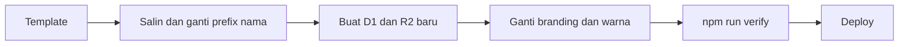

# Contoh Web dan Template

Web yang saya bangun sebagai contoh, dan template yang bisa dipakai ulang untuk klien baru.

## Template Web Yayasan

Basis untuk web donasi dan wakaf: Astro 5 SSR, Cloudflare Workers, D1, dan R2. Dibuat dari proyek [Web Donasi Yayasan](web-donasi-yayasan.md), tanpa data lokal dan rahasia.

Yang membuatnya bisa dipakai ulang:

- Satu berkas `TEMPLATE.md` berisi urutan langkah dan daftar berkas yang harus diganti.
- Nama resource memakai prefix netral yang diganti sekali.
- Data demo dipisah (`seed-demo`) dan dihapus saat produksi.
- Panduan deploy dan SOP admin ikut disertakan.
- `npm run verify` menjalankan typecheck, ESLint, dan 31 tes unit dan integrasi D1. Uji end-to-end memakai Playwright dengan profil iPhone dan Pixel.

Cuplikan kode: [code/web-donasi-yayasan](../code/web-donasi-yayasan)

## Situs Showcase 3D

Situs studio dengan hero 3D interaktif, animasi saat scroll, dan form kontak yang tersimpan ke database.

Next.js 16 (App Router, TypeScript, Tailwind v4), React Three Fiber, GSAP ScrollTrigger, Supabase, Playwright.

- Animasi scroll dibungkus satu hook dengan lima varian, jadi tiap section cukup memilih nama varian.
- Form kontak divalidasi di server, tabel pesan memakai RLS yang hanya mengizinkan insert dari anon.
- Ada uji smoke Playwright.

Cuplikan kode: [code/showcase-3d-filodev](../code/showcase-3d-filodev)

## Landing Page Rental Mobil

Dua landing page untuk usaha rental mobil di kota yang berbeda. Setiap halaman berupa satu berkas HTML tanpa framework, jadi cepat dimuat di jaringan seluler dan murah dihosting.

- Metadata SEO lengkap dan Open Graph.
- Data terstruktur JSON-LD tipe `AutoRental` agar usaha muncul rapi di hasil pencarian.
- Gambar WebP, tombol pesan langsung ke WhatsApp.
- Versi siap deploy (`versi-online`) berisi `_headers` dan `robots.txt`.

## Template Aplikasi Berikutnya

Pola yang sama dipakai di proyek lain: [Platform Kelas Online](platform-kelas-online.md) mengulang hash sandi, rate limit, dan webhook ber-HMAC dari proyek yayasan, dengan penyesuaian untuk kebutuhan kelas live dan tiga bahasa.
