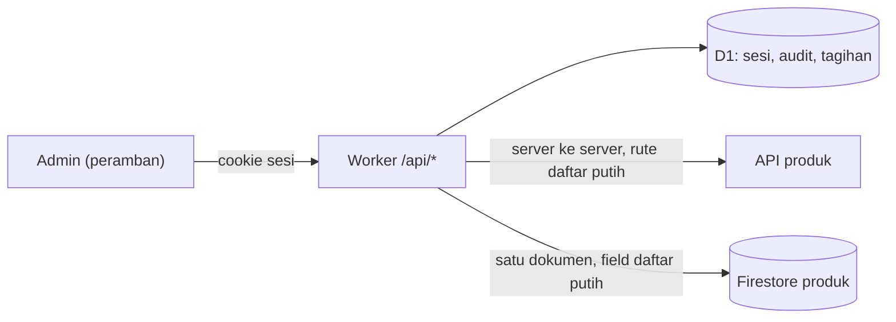
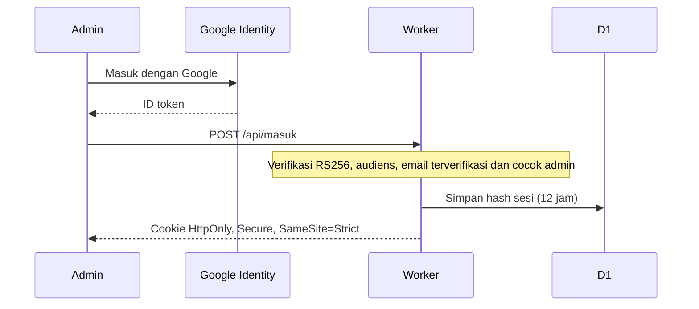
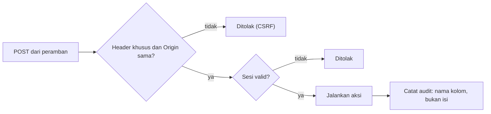
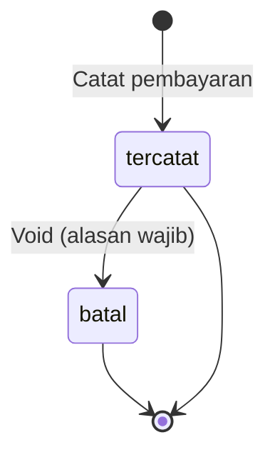

# Filodev Control Center

Satu panel admin untuk mengendalikan beberapa produk Filodev dan mencatat tagihan semua klien.

## Konteks

Tiap produk punya admin sendiri. Mengurus status langganan, jeda akun, pengumuman, dan tagihan dari beberapa tempat lambat dan mudah salah.

## Arsitektur

Worker hanya menangani `/api/*`. Halaman statis dilayani terpisah.

## Cara kerja

### 1. Login dan sesi

### 2. Setiap aksi yang mengubah data

### 3. Pembayaran dan koreksi

Pembayaran yang dibatalkan tetap ada di riwayat dan tidak ikut total.

## Keputusan teknis

**Tanpa dependensi runtime.** Worker ditulis dengan JavaScript biasa. Permukaan serangan kecil dan tidak ada paket yang perlu dipantau kerentanannya.

**Token layanan tidak pernah ke peramban.** Permintaan ke produk lain diteruskan dari server dengan token di sisi server, hanya ke rute pada daftar putih.

**Akses ke Firestore dibatasi sempit.** Worker memakai service account dengan peran minimal, hanya menyentuh satu dokumen status dan field pada daftar putih. Data penjualan tidak pernah dibaca. Akses dicabut dengan menghapus kunci.

**Pembayaran tidak dihapus.** Riwayat keuangan tetap utuh.

**Audit mencatat nama kolom, bukan isi.** Jejak perubahan tersedia tanpa menyimpan data sensitif dua kali.

## Fitur

Kontrol akun per produk (jeda, jalankan, jadwal lunas, pengumuman), buku tagihan lintas klien dengan status jatuh tempo, pengingat WhatsApp, kwitansi cetak bernomor, dan ekspor CSV.

## Stack

Cloudflare Workers, D1, Google Identity Services

## Pengujian

53 tes otomatis: login, sesi, CSRF, proxy daftar putih, audit, buku tagihan, logika tanggal, format kwitansi. Mode lokal dengan data palsu untuk uji manual.

## Cuplikan kode

[code/filodev-control-center](../code/filodev-control-center)
