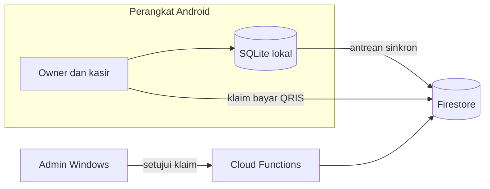
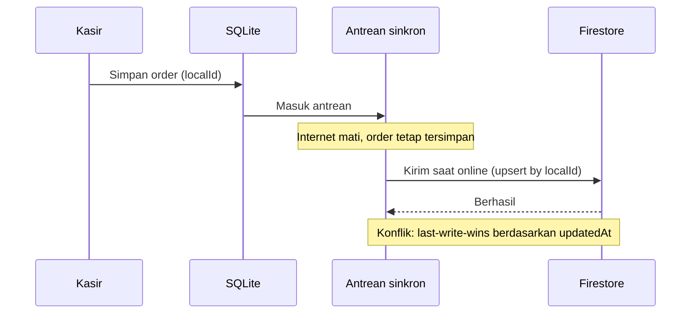
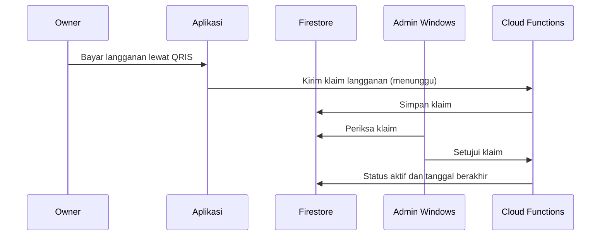
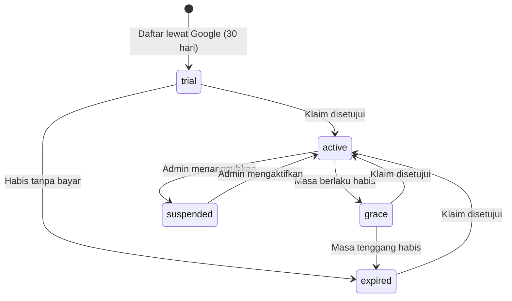

# FiloKasir dan FiloLaundry

SaaS kasir untuk laundry dan toko. Dua aplikasi Android dari satu kode dan satu backend, ditambah aplikasi admin Windows untuk mengelola semua pelanggan.

## Konteks

Pemilik usaha kecil butuh kasir yang tetap bisa dipakai saat internet mati, mendukung beberapa cabang, dan punya cara membayar langganan yang bisa diaktifkan dari satu panel admin.

## Arsitektur

## Cara kerja

### 1. Transaksi offline lalu sinkron

### 2. Langganan lewat QRIS dan persetujuan admin

Klien tidak menulis klaim maupun status langganan secara langsung. Aturan Firestore menutup keduanya, sehingga hanya fungsi di server yang mengubahnya.

Kode Google Play Billing (verifikasi pembelian dan notifikasi RTDN) sudah ditulis, tetapi dipensiunkan dan tidak aktif. Fungsinya dijawab dengan HTTP 410, dan yang berjalan sekarang adalah QRIS dengan persetujuan admin.

### 3. Siklus status tenant

Saat `expired`, aplikasi tidak bisa membuat order baru.

## Keputusan teknis

**Satu project Firebase untuk dua produk.** Data dipisah dengan `tenantId` dan `productId`. Admin cukup mengelola satu backend dan satu set aturan. Konsekuensinya aturan Firestore harus ketat, karena isolasi bergantung padanya.

**Dua aplikasi dari satu kode.** Flutter flavor menghasilkan FiloLaundry dan FiloKasir dari satu basis kode. Perbaikan di satu produk langsung berlaku di yang lain.

**Status langganan hanya diubah server.** Field langganan dilindungi aturan Firestore dan hanya Cloud Functions yang boleh menulisnya. Klien tidak dipercaya untuk status ini.

**Masa tenggang.** Setelah masa berlaku habis ada beberapa hari `grace` sebelum `expired`, supaya pelanggan tidak terkunci mendadak.

**Gerbang langganan memakai tanggal tersimpan.** Aplikasi tidak bisa dibuka kembali hanya dengan mematikan internet.

**Sinkron tanpa duplikat.** Setiap transaksi punya `localId`. Last-write-wins cukup untuk kasir yang mengubah data cabangnya sendiri.

**Login kasir dengan PIN.** Owner memasangkan perangkat ke cabang sekali. Setelah itu kasir hanya memasukkan PIN dan hanya melihat data cabangnya.

## Cakupan

- Owner: daftar lewat Google, masa percobaan 30 hari otomatis, kelola cabang dan kasir, laporan semua cabang.
- Kasir: order kiloan dan satuan, antrean, pembayaran tunai, transfer, QRIS, dan utang dengan DP, struk, shift, kas.
- Admin Windows: perpanjang, tangguhkan, atur harga, pindahkan produk.

## Stack

Flutter, Dart, SQLite, Firebase Auth, Firestore, Cloud Functions (Node.js)

## Status

PRD, rencana, dan panduan setup tersedia di repositori proyek (privat).

## Cuplikan kode

[code/filokasir-filolaundry](../code/filokasir-filolaundry)
