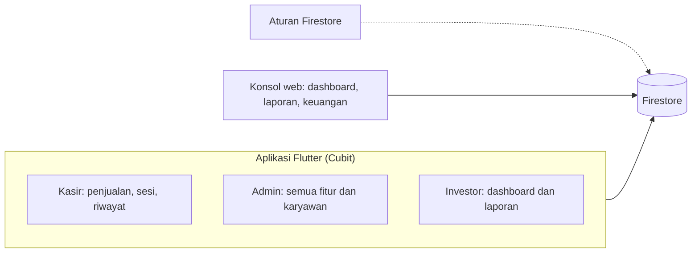
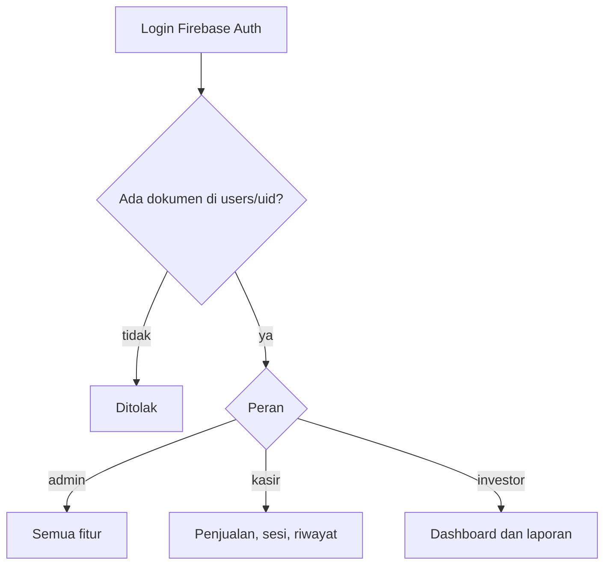
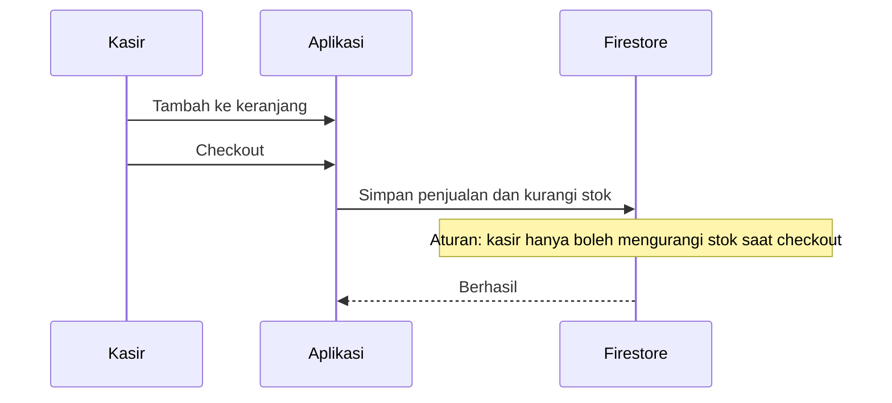

# Jam Kopi Kasir

Kasir untuk Jam Kopi Roastery, Pekanbaru.

## Arsitektur

## Cara kerja

### 1. Masuk dan peran

### 2. Penjualan dan stok

## Peran

| Peran | Akses |
| :-- | :-- |
| Admin | Semua fitur, termasuk mengelola karyawan |
| Kasir | Penjualan, sesi kasir, riwayat |
| Investor | Dashboard dan laporan; keuangan di web |

## Keputusan teknis

**Akun tanpa profil ditolak.** Akun baru harus punya dokumen di koleksi `users` yang dibuat admin. Membuat akun saja tidak memberi akses.

**Aturan stok di database.** Kasir hanya boleh mengurangi stok saat checkout, ditegakkan aturan Firestore.

**Web untuk laporan saja.** Konsol web hanya menampilkan dashboard, laporan, dan keuangan, bukan kasir penuh, sehingga permukaan yang terbuka lebih kecil.

**Skrip untuk lingkungan.** Data awal, deploy aturan, dan emulator lokal (Auth dan Firestore) dijalankan dengan skrip.

## Stack

Flutter, Cubit, Firestore, Firebase Auth, Firebase Hosting

## Cuplikan kode

[code/jam-kopi-kasir](../code/jam-kopi-kasir)
