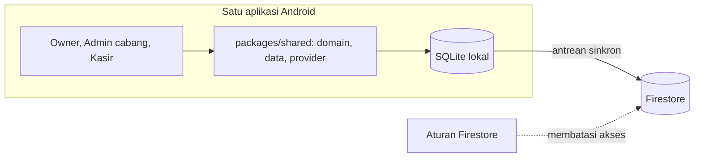
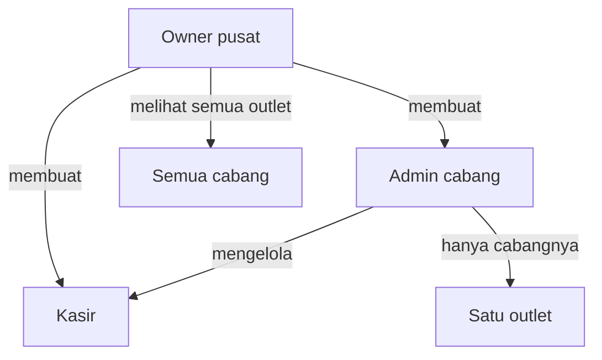
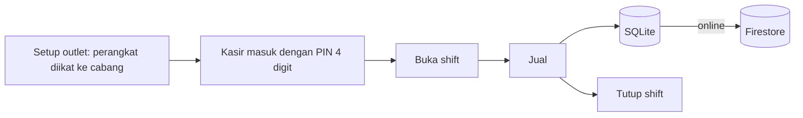

# Palmera POS

Kasir multi-outlet untuk Palmera Kebab & Shawarma. Owner, admin cabang, dan kasir memakai satu aplikasi Android.

## Konteks

Beberapa outlet harus dikontrol dari pusat, sementara kasir di tiap outlet tetap harus bisa berjualan saat koneksi putus.

## Arsitektur



## Cara kerja

### 1. Hierarki peran



### 2. Alur harian di outlet



## Struktur

Monorepo Flutter dengan Melos.

```
apps/pos_tablet     aplikasi Android
packages/shared     domain, data, tema, provider
firebase/           aturan Firestore, indeks, data awal
docs/               checklist UAT, panduan go-live
scripts/            build APK, deploy
```

## Keputusan teknis

**Satu aplikasi untuk tiga peran.** Distribusi dan pembaruan jadi satu jalur, dan kode domain di `packages/shared` tidak diduplikasi.

**Perangkat diikat ke outlet.** Saat setup, perangkat dipasangkan ke cabang. Kasir masuk dengan PIN 4 digit unik lalu membuka shift.

**PIN disimpan sebagai hash bcrypt.** Bcrypt sengaja lambat dihitung, sehingga PIN sulit ditebak dengan percobaan massal.

**Berjalan di paket gratis.** Backend hanya Firestore dan Auth anonim, tanpa Cloud Functions. Logika yang butuh server ditaruh di aturan database atau di aplikasi. Cloud Functions disiapkan sebagai opsi bila nanti pindah ke paket berbayar.

**Offline-first.** Cache SQLite dan antrean sinkron ke Firestore.

## Stack

Flutter 3, Material 3, Riverpod, go_router, SQLite, Firestore, bcrypt, Melos

## Operasional

Skrip build APK (bootstrap, uji, build, salin ke `dist/`), skrip deploy aturan dan indeks, dan checklist UAT per outlet.

## Cuplikan kode

[code/palmera-pos](../code/palmera-pos)
