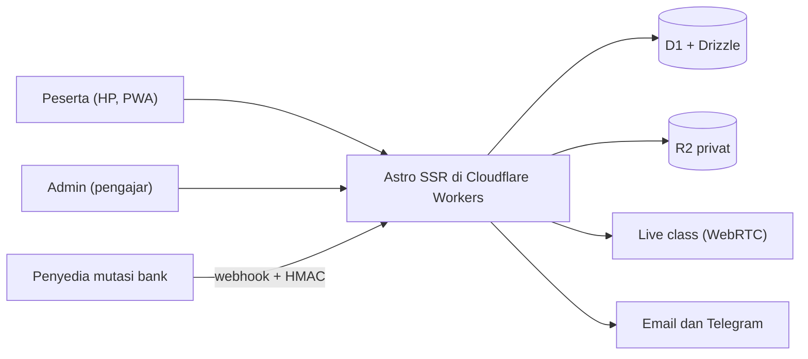
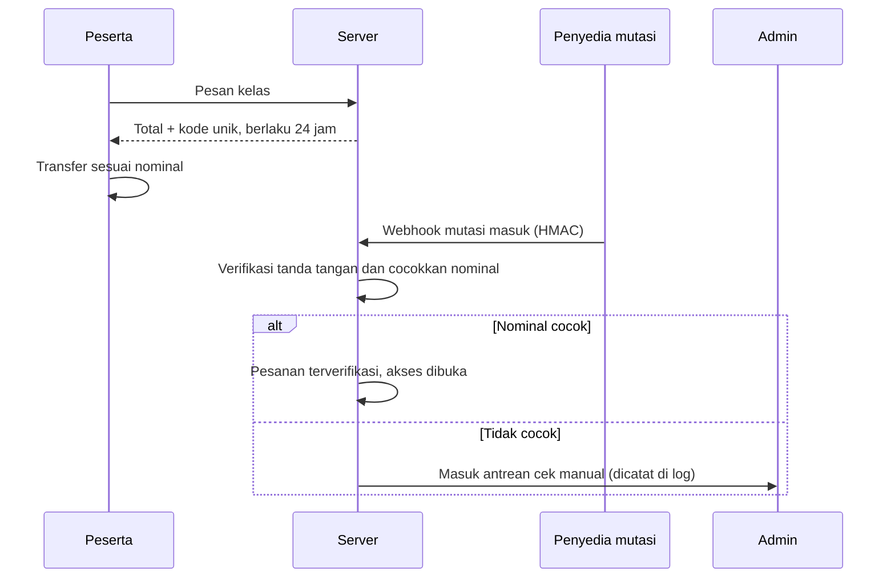
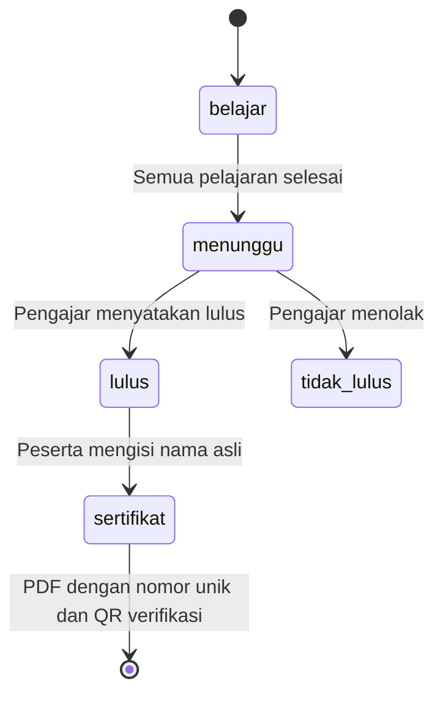

# Platform Kelas Online

Web kelas online dan e-book untuk seorang pengajar bahasa Arab dan Al-Qur'an. Peserta belajar lewat HP, ikut kelas live, mengerjakan kuis, dan mendapat sertifikat yang bisa diverifikasi publik.

## Konteks

Pengajar sebelumnya menjual kelas lewat chat dan transfer manual. Ia butuh satu tempat untuk katalog, pembayaran, materi, kelas live, dan sertifikat, yang nyaman dipakai di HP dan tidak butuh server yang dijaga.

## Arsitektur

## Cara kerja

### 1. Pembayaran transfer dengan kode unik

Tidak membuat gateway sendiri. Pesanan mendapat total dengan kode unik 3 digit, lalu webhook dari pembaca mutasi bank mencocokkan nominalnya.

### 2. Dari selesai belajar sampai sertifikat

## Keputusan teknis

**Pembayaran lewat lapisan `PaymentProvider`.** Webhook dinormalkan ke satu bentuk (`ref`, `nominal`), sehingga penyedia mutasi bisa diganti tanpa menyentuh logika pesanan. Tanda tangan HMAC diperiksa dengan perbandingan waktu konstan.

**Sandi dengan PBKDF2 di WebCrypto.** Workers membatasi iterasi, jadi versi iterasi ikut disimpan di hash dan bisa dinaikkan lewat hash ulang setelah login. Respons untuk surel yang tidak terdaftar memakai hash palsu agar waktunya sama. Sandi diperiksa juga terhadap daftar bocor dengan k-anonymity.

**CSP tanpa skrip inline.** Skrip hanya dari berkas sendiri, jadi XSS yang menyisipkan `<script>` tidak jalan. Pemeriksaan di skrip build menggagalkan build bila ada skrip inline.

**Rate limit di tepi, gagal-terbuka.** Kunci memakai pengguna bila sudah login supaya jaringan bersama tidak saling mengunci. Bila layanan pembatas bermasalah, situs tetap melayani.

**Tiga bahasa.** Indonesia, Inggris, dan Arab (kanan-ke-kiri) dari satu set kamus yang diperiksa di build.

**Sertifikat bisa diverifikasi.** Nomor unik dan QR menuju halaman verifikasi publik. Nama di sertifikat hanya bisa dikoreksi lewat admin, dan tercatat di log.

## Cakupan

Katalog kelas dan e-book, kupon dan bundel, pelajaran yang terbuka sesuai jadwal, kuis, kelas live dengan ruang tunggu, komentar dan ulasan, notifikasi, sertifikat, panel admin lengkap dengan log audit, PWA, dan asisten untuk pengajar.

## Stack

Astro (SSR), Cloudflare Workers, D1, Drizzle ORM, R2, WebRTC, Turnstile, Google OAuth, Vitest

## Cuplikan kode

[code/platform-kelas-online](../code/platform-kelas-online)
