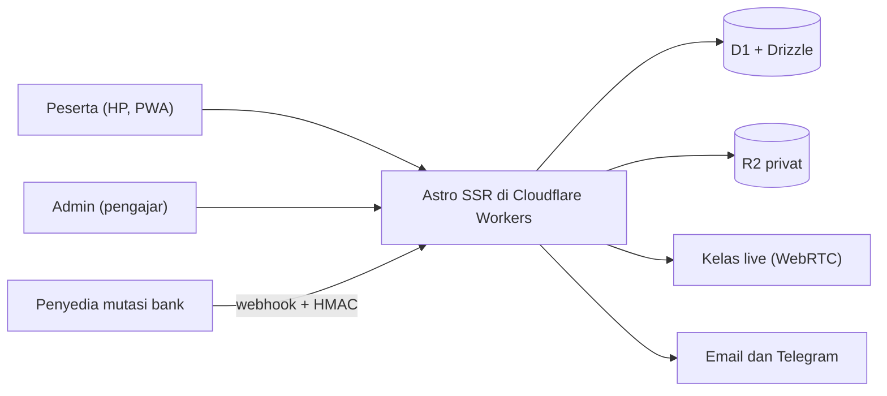
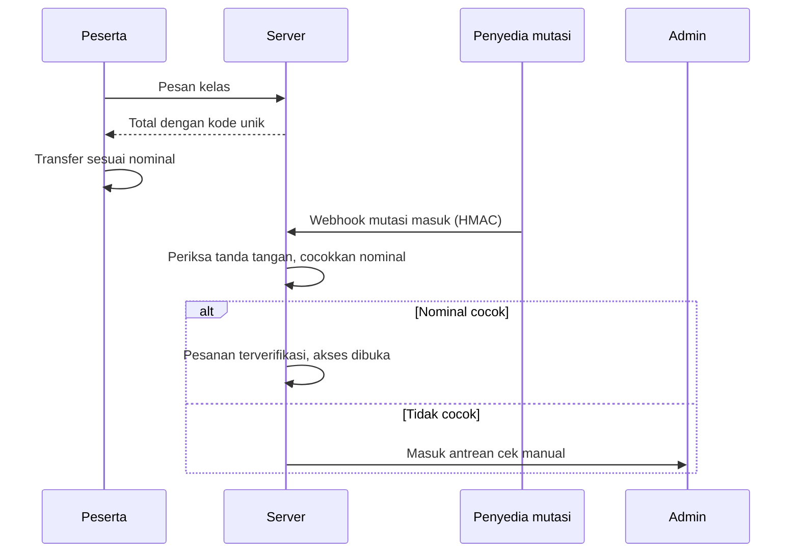
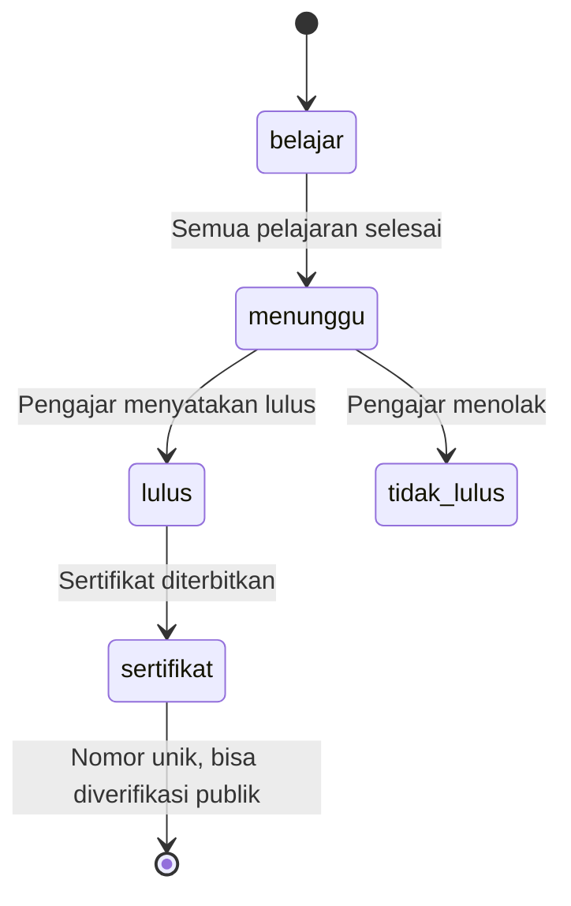

# Platform Kelas Online

Web kelas online dan e-book untuk seorang pengajar bahasa Arab dan Al-Qur'an. Peserta belajar lewat HP, ikut kelas live, mengerjakan kuis, dan mendapat sertifikat yang bisa diperiksa keasliannya.

## Konteks

Pengajar ini sebelumnya menjual kelas lewat chat dan transfer manual. Ia butuh satu tempat untuk katalog, pembayaran, materi, kelas live, dan sertifikat, yang nyaman dibuka di HP dan tidak memerlukan server yang dijaga.

## Arsitektur

## Cara kerja

### 1. Pembayaran transfer dengan kode unik

Pembayaran tidak lewat gateway. Setiap pesanan mendapat total dengan kode unik, lalu webhook dari pembaca mutasi bank mencocokkan nominalnya.

### 2. Dari selesai belajar sampai sertifikat

## Keputusan teknis

**Pembayaran lewat lapisan `PaymentProvider`.** Webhook diubah ke satu bentuk data (`ref` dan `nominal`), sehingga penyedia mutasi bisa diganti tanpa menyentuh logika pesanan. Tanda tangan HMAC dibandingkan dalam waktu konstan.

**Sandi dengan PBKDF2 di WebCrypto.** Workers membatasi jumlah iterasi, jadi versi iterasi disimpan bersama hash dan bisa dinaikkan lewat hash ulang setelah login. Surel yang tidak terdaftar tetap diproses dengan hash palsu supaya waktu responsnya sama. Sandi juga diperiksa terhadap daftar sandi bocor dengan k-anonymity.

**CSP tanpa skrip inline.** Skrip hanya dimuat dari berkas sendiri, sehingga `<script>` yang disisipkan lewat XSS tidak berjalan. Skrip build menggagalkan build bila menemukan skrip inline.

**Rate limit di tepi.** Kuncinya pengguna bila sudah login, supaya jaringan bersama tidak saling mengunci. Bila layanan pembatas bermasalah, situs tetap melayani permintaan.

**Tiga bahasa.** Indonesia, Inggris, dan Arab (kanan ke kiri), dari kamus yang diperiksa saat build.

## Cakupan

Katalog kelas dan e-book, kupon, pelajaran dan kuis, kelas live, komentar dan ulasan, notifikasi, sertifikat dengan halaman verifikasi, panel admin dengan log audit, dan PWA.

## Stack

Astro (SSR), Cloudflare Workers, D1, Drizzle ORM, R2, WebRTC, Turnstile, Google OAuth, Vitest

## Cuplikan kode

[code/platform-kelas-online](../code/platform-kelas-online)
