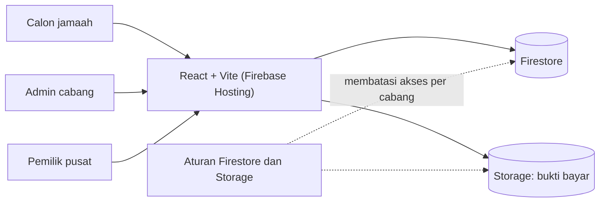
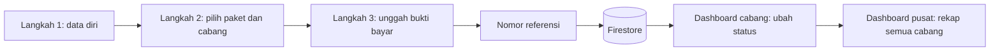
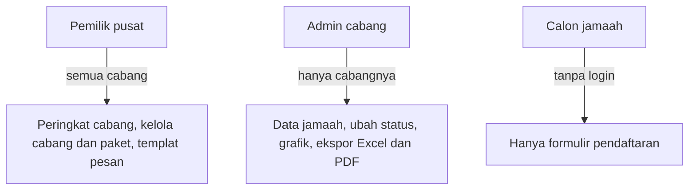
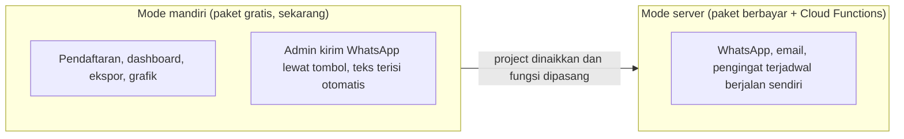

# Registrasi Jamaah Umroh

Sistem pendaftaran jamaah online untuk sebuah biro perjalanan umroh.

## Konteks

Pendaftaran tersebar di beberapa cabang dan dicatat manual, sehingga pusat sulit melihat jumlah pendaftar dan kinerja tiap cabang.

## Arsitektur



## Cara kerja

### 1. Alur pendaftaran



### 2. Hak akses



### 3. Dua mode yang berpindah otomatis



## Struktur

```
frontend/           React, Vite, Tailwind
  src/pages/        halaman
  src/components/   komponen ulang
  src/services/     database, ekspor, WhatsApp
  src/hooks/        logika bersama
backend/functions/  Cloud Functions (jamaah, WhatsApp, email, auth)
firestore.rules     aturan baca dan tulis
storage.rules       aturan berkas bukti bayar
docs/               panduan admin, pemasangan, keamanan, status
```

## Keputusan teknis

**Dua mode yang berpindah otomatis.** Kode untuk mode server sudah ada, jadi klien tidak perlu pengerjaan ulang saat naik paket.

**Pembatasan per cabang di aturan database.** Admin cabang hanya bisa membaca dan mengubah data cabangnya, ditegakkan oleh aturan Firestore dan bukan hanya antarmuka.

**Dokumentasi untuk non-teknis.** Panduan admin ditulis dengan bahasa sederhana untuk pemakaian harian.

## Stack

React, Vite, Tailwind CSS, Firebase (Firestore, Storage, Hosting, Cloud Functions)

## Cuplikan kode

[code/registrasi-umroh](../code/registrasi-umroh)
