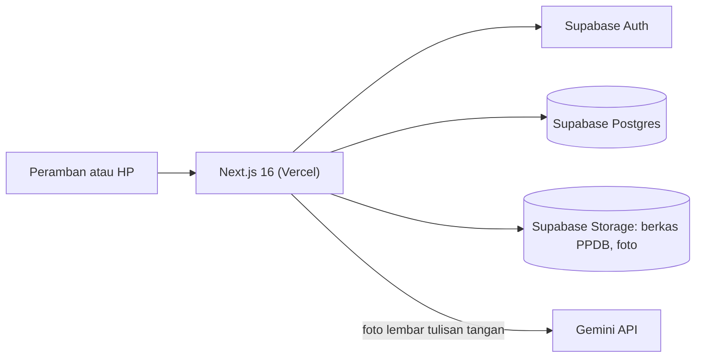
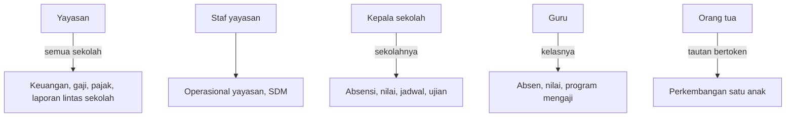
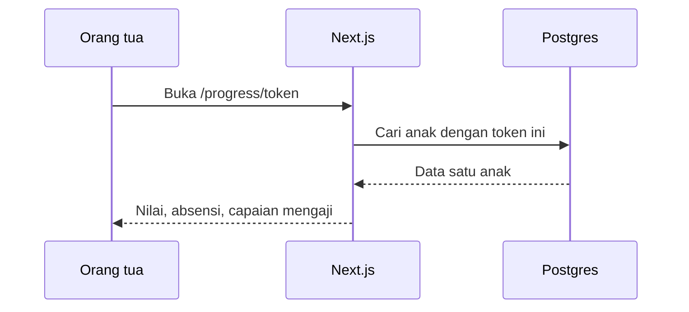
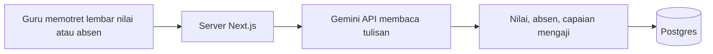
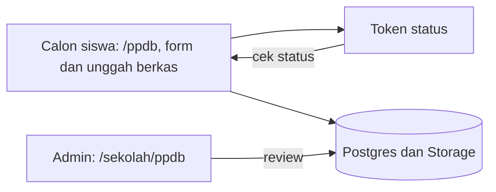

# Sistem Yayasan dan Sekolah

Aplikasi web untuk yayasan dengan beberapa jenjang sekolah. Dirancang mobile-first karena sebagian besar guru memakainya lewat HP.

## Konteks

Yayasan dengan beberapa jenjang butuh satu sistem untuk absensi, nilai, keuangan, dan komunikasi ke orang tua, dengan hak akses yang berbeda untuk tiap jabatan.

## Arsitektur

## Cara kerja

### 1. Peran dan akses

### 2. Akses orang tua tanpa akun

### 3. Input dari foto

### 4. PPDB online

## Modul

- Absensi guru dan siswa, data siswa, kelas, tahun ajaran, riwayat kenaikan kelas
- Nilai dan rapor dengan skema penilaian yang bisa diatur
- Program mengaji (Iqro, Quran, Tahsin)
- SPP, keuangan yayasan, gaji dan slip gaji, pajak yayasan
- Perpustakaan: koleksi, peminjaman, denda
- Jadwal pelajaran dan agenda ujian
- PPDB online dan kartu pelajar
- Laporan lintas sekolah

## Keputusan teknis

**Next.js dan Supabase, bukan Laravel dengan VPS.** Repositori referensi memakai Laravel, MySQL, Redis, dan MinIO, yang butuh server menyala terus dengan biaya bulanan dan perawatan sendiri (patch keamanan, backup, uptime). Dengan Vercel dan Supabase, hosting gratis dan tidak ada server yang dijaga. Fondasi yang sudah ada, termasuk fitur khusus seperti input dari foto, tidak perlu ditulis ulang. Repositori Laravel tetap dipakai sebagai daftar acuan modul, lalu diterjemahkan ke stack ini. Pindah ke VPS tetap mungkin saat sudah produksi penuh.

**Orang tua tanpa akun.** Akses lewat tautan bertoken. Tidak ada kata sandi untuk dikelola atau dilupakan, dan setiap tautan hanya membuka satu anak.

**Migrasi database terversi.** Skema berubah lewat berkas migrasi bernomor, bukan perubahan manual.

## Stack

Next.js 16, React 19, TypeScript, Supabase (Postgres, Auth, Storage), Tailwind CSS 4, Zod, Gemini API, face-api.js

## Status

Modul utama berjalan di database produksi. Antarmuka sedang disusun ulang bertahap berdasarkan panduan desain per peran: token desain, ikon konsisten, navigasi bawah untuk mobile, dan sidebar untuk desktop.
