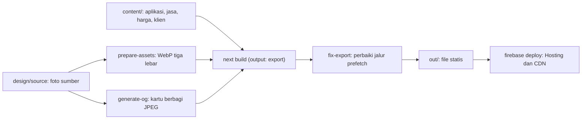
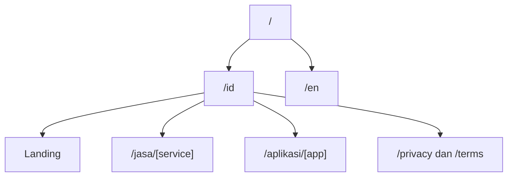

# Situs Filodev

Situs studio dalam bahasa Indonesia dan Inggris. https://filodev-web.web.app

## Cara kerja

### 1. Dari konten ke situs

### 2. Struktur halaman

Halaman `/en` memiliki struktur yang sama.

## Keputusan desain dan teknis

**Hero foto menggantikan adegan 3D.** Versi awal memakai adegan 3D interaktif. Saya ganti dengan satu foto diam dan kartu yang tingginya mengikuti isi. Halaman lebih cepat dimuat di HP dan lebih mudah dirawat.

**Ekspor statis.** Tidak ada form dan tidak ada API route, jadi tidak ada server yang dijaga. Dependensi runtime hanya `next`, `react`, dan `react-dom`.

**Satu sumber data.** Halaman produk dan jasa dibangkitkan dari `content/`.

**Dua bahasa lewat rute.** `/id` dan `/en`, dengan metadata dan JSON-LD per halaman.

**Pipeline aset.** Logo klien dibersihkan latarnya otomatis, dan kartu berbagi dibuat dengan sharp. Dengan JPEG, ukuran kartu turun dari sekitar 2 MB (PNG) menjadi 126 KB.

**Analitik opsional.** Tidak aktif kecuali dikonfigurasi, dan memakai penyedia tanpa cookie. Halaman privasi mengikuti konfigurasi itu.

## Stack

Next.js 16, React, TypeScript, sharp, Firebase Hosting

## Cuplikan kode

[code/situs-filodev](../code/situs-filodev)
