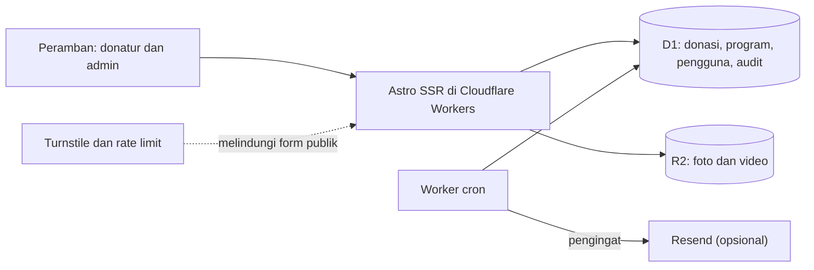
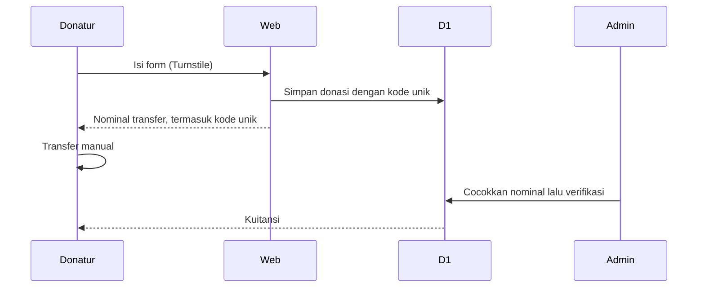
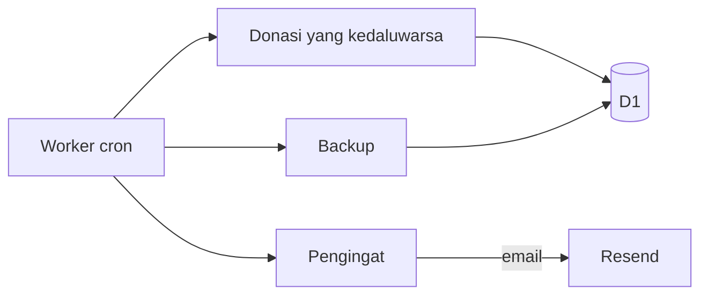
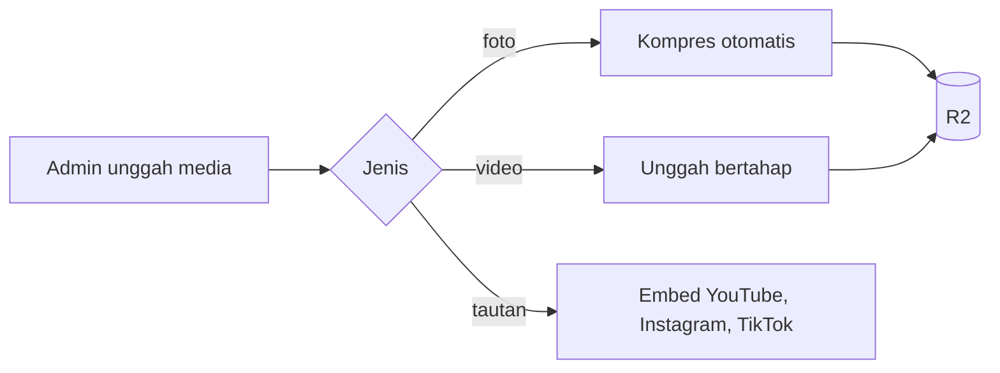

# Web Donasi Yayasan

Situs donasi dan wakaf untuk sebuah yayasan sosial, dengan panel admin.

## Konteks

Yayasan menerima donasi lewat transfer manual. Mereka butuh cara mencocokkan pembayaran, menerbitkan kuitansi, dan menampilkan kegiatan, dengan biaya server yang rendah.

## Arsitektur



## Cara kerja

### 1. Alur donasi manual



Verifikasi bisa dibatalkan. Donatur bisa memulihkan akses ke kuitansinya.

### 2. Pekerjaan terjadwal



### 3. Unggah galeri



## Struktur

Monorepo dengan tiga bagian.

```
apps/web          Astro: halaman publik, admin, API
packages/db       skema Drizzle, migrasi, helper D1
packages/shared   utilitas dan validasi Zod
docs/             DEPLOY.md, SOP-ADMIN.md
```

## Keputusan teknis

**Kode unik pada nominal transfer.** Pembayaran manual dicocokkan dari nominalnya. Admin memverifikasi atau membatalkan verifikasi.

**Astro SSR di Workers dengan D1 dan R2.** Tidak ada server yang dijaga, dan biaya mengikuti pemakaian.

**Form publik berlapis.** Turnstile dan rate limit pada semua form.

**Pekerjaan terjadwal dipisah.** Worker cron mengurus kedaluwarsa, backup, dan pengingat.

**Audit terpusat.** Semua aksi admin tercatat di satu tempat.

## Fitur lain

Galeri dengan urutan seret-lepas dan jadwal tayang. PWA, JSON-LD, gambar OG dinamis. Tabel admin yang nyaman di layar HP.

## Stack

Astro 5, Cloudflare Workers, D1, R2, Drizzle ORM, Zod, Turnstile, Resend

## Pengujian

`npm run verify` menjalankan pengecekan tipe, ESLint, dan 31 tes unit dan integrasi dengan D1. Tes end-to-end Playwright memakai profil iPhone dan Pixel.
